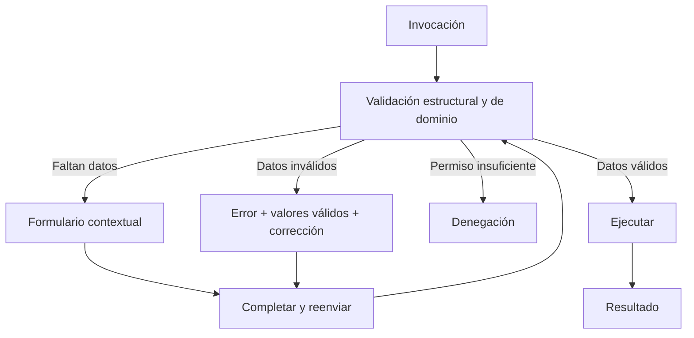

# AIF — Agent Interaction Forms
## Research previo al PRD

**Versión:** 0.1.2 (§§7–12 alineadas con PRD 0.1.4; véase la adenda de §14) · **Fecha:** 2026-11-24 · **Estado:** investigación inicial, no normativa

## 1. Resumen ejecutivo

AIF nace de ACM como patrón de interacción entre agentes probabilísticos y herramientas deterministas. Su propuesta es ejecutar directamente cuando los datos son suficientes y, cuando no lo son, devolver un formulario contextual, corregible y acompañado de una continuación explícita.

La investigación identifica antecedentes sólidos en ACI, MCP, interfaces CLI para agentes, hipermedia, JSON Schema y gestión de reintentos. Ninguno de los documentos examinados establece por sí solo que AIF sea una innovación inédita. La oportunidad consiste en combinar mecanismos conocidos en un contrato pequeño, interoperable y verificable, con énfasis inicial en CLI locales.

**Recomendación:** avanzar al PRD de un protocolo abierto y ligero, no de un framework de agentes. Go es candidato a implementación de referencia; el contrato debe poder implementarse también en Python u otros lenguajes sin invocar Go.

## 2. Método y alcance

Revisión documental dirigida de fuentes primarias: publicaciones académicas, especificaciones, RFC, documentación de ingeniería y código de los dos proyectos de origen. Se distingue entre hechos documentados, inferencias de diseño e hipótesis experimentales. No se han ejecutado benchmarks nuevos ni se ha realizado una búsqueda exhaustiva de patentes, nombres o implementaciones comerciales.

Preguntas: ¿qué mecanismos ya existen?, ¿qué debería reutilizar AIF?, ¿qué valor diferencial es plausible?, ¿cómo medirlo? Las referencias numeradas aparecen al final. Las versiones de documentos vivos deben fijarse antes de redactar la especificación normativa.

## 3. Punto de partida: evidencia propia

### 3.1 ACM [R01]

El adaptador actual permite invocar eventos con flags completos o recibir un formulario si faltan datos obligatorios. Los campos incluyen `required`, `value`, `allowed` y `hint`; el formulario incorpora evento, identidad y sesión. `submit` recibe JSON por stdin. Los errores de validación conservan los valores válidos. La idempotencia por `form_id` y la deduplicación por contenido son mecanismos distintos. ACM usa SQLite y db-ai; estos no deben convertirse en requisitos universales de AIF.

La documentación recoge una prueba puntual (n=1):

| Variante | Invocaciones | Tokens | Coste | Fallos declarados |
|---|---:|---:|---:|---|
| AIF | 21 | 22.900 | 0,0186 USD | 0 de submit |
| Convencional | 17 | 12.700 | 0,0140 USD | No informado |
| db-ai directo | 31 | 106.000 | 0,0615 USD | 6 errores |

AIF consumió aproximadamente un 78 % menos de tokens que db-ai directo y un 80 % más que la interfaz convencional. Los fallos se describen con categorías no necesariamente equivalentes. No hay evidencia estadística de superioridad sobre una buena CLI convencional. La experiencia motiva investigar, no permite prometer ahorros universales.

### 3.2 Orchestrator Runner [R02]

El runner define once fases, `next`, `skip`, `reset`, `boot` y una consulta JSON. `next` sin evidencia ya desempeña una autodescripción contextual textual. La evidencia de avance es libre y el estado se registra en `.run/orchestrator-runner.json`. Un formulario generado según la fase permitiría estructurar la evidencia y detectar un envío obsoleto. El runner seguiría siendo responsable de sus transiciones y de verificar hechos y autorizaciones.

Riesgo específico: repetir `next` tras perder la respuesta puede avanzar otra fase. La identidad de operación y la precondición de estado son por ello más relevantes que la deduplicación por texto. No se recomienda modificar ACM ni el runner durante esta investigación.

## 4. Estado del arte

### 4.1 ACI y SWE-agent — diseño para agentes [R03]

El trabajo presentado en NeurIPS 2024 aporta evidencia de que la interfaz influye en el desempeño de agentes de programación. Su objeto de estudio incluye navegación, edición y feedback del entorno. AIF puede entenderse como un patrón dentro de ACI, no como sustituto de toda la disciplina. La lección es evaluar la interfaz en tareas reales y no únicamente su elegancia formal.

### 4.2 Anthropic — herramientas evaluadas con agentes [R04]

Su guía de ingeniería recomienda elegir operaciones útiles, devolver contexto significativo y controlar el volumen de respuestas; propone desarrollar evaluaciones para iterar sobre herramientas. Para AIF esto implica respuestas compactas, descripciones sin redundancia y comparar resultados de extremo a extremo, no solo el tiempo del validador.

### 4.3 The CLI Spec — competidor y complemento próximo [R05, R06]

La versión 0.2 está congelada; la 0.3 consultada es candidata y puede cambiar. Trata salidas estructuradas, introspección, separación de canales, ejecución no interactiva, seguridad de reintentos y control de tamaño. La candidata distingue operaciones de lectura, idempotentes y no idempotentes.

AIF debería evitar duplicar una descripción global de comandos si ya existe. Su hipótesis diferencial es el contrato de continuación específico de una operación y su contexto, incluida la recuperación de un formulario incompleto. Se propone estudiar compatibilidad con 0.2 y revisar 0.3 antes de adoptar sus convenciones. No se considera un estándar industrial universal por el mero hecho de publicarse como especificación.

### 4.4 MCP — herramientas y elicitation [R07, R08, R09]

MCP permite declarar esquemas de entrada y salida de herramientas. Elicitation permite solicitar información adicional al usuario a través del cliente, con formularios y, en la revisión examinada de 2026, también navegación externa para determinadas interacciones sensibles. Es el antecedente agentic más próximo a la petición dinámica de datos, pero su destinatario y ciclo de interacción no son idénticos al formulario CLI de ACM.

Un adaptador MCP podría transportar AIF como resultado estructurado de una herramienta; no es obligatorio convertir cada formulario AIF en una solicitud al humano. El agente puede resolver datos que ya conoce; las decisiones humanas deben escalarse por mecanismos confiables. No se debe confundir una anotación de idempotencia con una garantía efectiva.

### 4.5 JSON Schema — validación [R10]

Draft 2020-12 ofrece una base para describir objetos, campos obligatorios, enumeraciones y restricciones. AIF debería evaluar un perfil explícito y pequeño antes de crear un lenguaje propio. El esquema describe validez estructural, no necesariamente permisos, estado vigente ni verdad factual. Los valores por defecto necesitan una semántica de aplicación clara; no asumir que un validador rellena campos automáticamente.

### 4.6 Hipermedia — JSON Hyper-Schema y Siren [R11, R12]

Hyper-Schema describe vínculos y acciones sobre representaciones JSON. Siren ofrece acciones con campos y destinos. Son antecedentes directos de la idea de que la respuesta puede enseñar al consumidor cómo continuar. AIF no inventa los formularios hipermedia: adapta esa filosofía al consumidor LLM, a la recuperación de errores y a transportes no necesariamente HTTP. Estudiar acciones tipadas y evitar que instrucciones de texto sean la única fuente de control.

### 4.7 RFC 9457 — errores accionables [R13]

Define un modelo de detalles de problemas para HTTP, con identificadores de tipo y posibilidad de extensiones. AIF puede inspirarse en la separación de código estable, descripción y detalles estructurados sin exigir un formato HTTP para CLI. El consumidor debe poder decidir qué corregir sin analizar prosa. No se debe proclamar conformidad RFC si solo se reutiliza el patrón.

### 4.8 RFC 9110 — idempotencia y concurrencia [R14]

Distingue el efecto pretendido de una operación de la respuesta concreta y contempla solicitudes condicionales como `If-Match`. Aplicación propuesta: separar identidad del envío, revisión del recurso y resultado de ejecución. No reintentar automáticamente operaciones de efecto desconocido. Una precondición sobre la revisión evita aplicar formularios a estados distintos del que los originó.

## 5. Comparativa de mecanismos

Leyenda: E = mecanismo explícito en la fuente; P = parcial, relacionado o dependiente del dominio; — = no identificado como parte central en la documentación examinada. No implica imposibilidad técnica.

| Referencia | Esquema | Continuación contextual | Corrección preservando datos | Reintento seguro | CLI nativa |
|---|---|---|---|---|---|
| ACI/SWE-agent | P | P | P | — | P |
| CLI Spec 0.3 candidata | E | P | — | E | E |
| MCP tools + elicitation | E | E | P | P | — |
| JSON Schema | E | — | — | — | — |
| Hyper-Schema / Siren | E/P | E | — | — | — |
| RFC 9457 | P | P | — | — | — |
| RFC 9110 | — | P | — | E | — |
| ACM actual | E, propio | E | E | E, submit | E |
| AIF propuesto | E | E | E | Diferido a v0.2 | E |

La última fila es una aspiración de diseño, no un producto existente ni una evaluación de conformidad.

## 6. Hipótesis de diferenciación

**H01.** Una herramienta que devuelve únicamente los datos faltantes y una acción de continuación reduce la exploración de ayuda frente a una CLI tradicional.

**H02.** Preservar entradas válidas durante la corrección reduce reenvíos erróneos y trabajo del agente.

**H03.** La ejecución directa como camino rápido evita penalizar casos sencillos con rondas de formulario obligatorias.

**H04.** Un contrato explícito de reintento y revisión de estado reduce dobles efectos y transiciones incorrectas.

**H05.** Un mismo conjunto de casos de conformidad puede ejecutarse con consumidores Python y Go, sin depender del modelo LLM ni del transporte.

Estas hipótesis requieren comparación con una CLI JSON bien diseñada y, cuando proceda, MCP; un baseline deliberadamente deficiente inflaría el beneficio.

## 7. Modelo conceptual candidato (no normativo)

El núcleo de v0.1 es un bucle mínimo: ejecutar si los datos bastan; si faltan, devolver el formulario; si son inválidos, devolver el error con los valores válidos; si el dominio deniega, bloquear sin invitar a eludir el permiso.



Ejemplo ilustrativo de continuación (nombres de campos pendientes de especificación; el dominio es el del runner solo como ilustración):

```json
{
  "status": "needs_input",
  "operation": "advance",
  "schema": {
    "type": "object",
    "required": ["approval_ref", "risk"],
    "properties": {
      "approval_ref": {"type": "string", "minLength": 1},
      "risk": {"type": "string", "minLength": 1}
    }
  },
  "values": {"risk": "none"},
  "next": {"operation": "submit"}
}
```

No representa el contrato actual del runner ni una versión final de AIF. La referencia de aprobación debe verificarse en el dominio; su mera presencia no autoriza nada. Una acción lógica se traduciría a CLI u otro transporte mediante un adaptador confiable, no mediante ejecución arbitraria de una cadena de shell.

**Línea futura (v0.2, no requisito de v0.1):** identidad de formulario, revisión del estado y clave idempotente (`form_id`, `revision`) para operaciones con estado, como el avance de fase del runner. Se estudiarán solo si el filtro del PRD §7 resulta en GO.

## 8. Determinismo, seguridad e integridad

**Aplica a v0.1**

- Determinismo significa que, con los mismos datos, reglas, contexto y estado, las decisiones de validación son reproducibles. No obliga a que UUID, relojes o resultados externos sean idénticos byte a byte.
- Distinguir input faltante, input inválido, denegación y fallo de ejecución. No convertir denegaciones en ciclos de reparación automáticos. Un fallo del dominio no se presenta nunca como éxito.
- Los campos y metadatos enviados por el agente no son autoridad; comprobar identidad, permisos, contexto y reglas en el ejecutor. No aceptar credenciales en formularios ordinarios ni interpretar texto de herramientas como instrucciones privilegiadas.
- Limitar tamaño y profundidad de la entrada; rechazar JSON ambiguo, claves duplicadas y versiones incompatibles según una política explícita. No bloquear stdin esperando diálogo humano en ejecución no interactiva.
- Las garantías que ACM ya ofrece (idempotencia por `form_id`, deduplicación por contenido) permanecen en ACM; AIF no las elimina ni las generaliza en v0.1. AIF no debe anunciar garantías de reintento que el ejecutor no pueda cumplir.

**Línea futura (v0.2)**

- Separar formulario (continuación), intento (observabilidad), clave idempotente (efecto) y revisión (concurrencia). La deduplicación semántica del contenido pertenece al dominio.
- Una clave repetida con datos incompatibles debe producir conflicto; un formulario obsoleto no debe actuar sobre otra revisión. Definir ámbitos por herramienta, proyecto y actor, caducidad y política de recuperación.
- Coordinar atómicamente el registro de idempotencia y el efecto cuando sea posible; si no, declarar estados inciertos y reconciliación. No prometer exactly-once sobre subprocesos arbitrarios. No reintentar automáticamente operaciones de efecto desconocido.
- Limitar el número de rondas y el tiempo cuando existan continuaciones persistentes.

## 9. Go frente a Python

El entorno de desarrollo inicial es Linux/WSL. En ese entorno, un binario Go estático se distribuye sin intérprete ni entorno virtual, y Python 3 suele estar disponible. La portabilidad a Windows nativo queda diferida.

| Alternativa | Ventaja | Coste / riesgo |
|---|---|---|
| Go SDK + CLI | Distribución binaria y uso nativo en CLI Go | Integración externa y coste de procesos desde Python |
| Python biblioteca | Adopción directa en ACM, cuyo adaptador es Python | Distribución, intérprete y entornos |
| Contrato + implementaciones independientes | Interoperabilidad real | Suites de conformidad y mantenimiento; fuera del MVP |

Recomendación: el contrato JSON es lo primero. La elección entre Go y Python es una decisión pendiente (PRD D-03) que se reevalúa tras el experimento; no se exige una segunda implementación en v0.1. Un validador JSON Schema completo no forma parte de la biblioteca estándar de Go: reutilizar una dependencia madura o documentar un perfil reducido, sin prometer conformidad completa si no se implementa. Medir el sobrecoste de proceso CLI antes de convertir un helper externo en dependencia obligatoria.

## 10. Plan experimental

**Filtro temprano (antes de Specification).** Se define únicamente en [PRD.md](PRD.md) §7 (puerta GO/NO-GO/INCONCLUSO) y [EXPERIMENT.md](experiment/EXPERIMENT.md) (protocolo): ACM frente a una CLI JSON competente que comparta ejecutor, validadores y permisos, un modelo fijado, tres escenarios y 30 ejecuciones. No se repiten aquí sus umbrales.

**Benchmark ampliado (condicional).** Solo si el filtro resulta en GO y la evidencia lo justifica: añadir CLI convencional documentada, MCP equivalente cuando sea viable, dos modelos de capacidades diferentes, al menos 30 repeticiones por combinación prioritaria, orden aleatorio y versiones fijadas. Registrar errores y abandonos, no solo ejecuciones exitosas. Comparar tasas e intervalos de incertidumbre; un único ejemplo no es prueba concluyente.

| Escenario | Oráculo verificable | Fase |
|---|---|---|
| ACM: captura completa | Una escritura correcta y una invocación de camino directo | Filtro v0.1 |
| ACM: campo obligatorio ausente | Formulario, sin mutación de dominio | Filtro v0.1 |
| ACM: enum inválido | Corrección; conservación de valores válidos | Filtro v0.1 |
| Interoperabilidad Go/Python | Mismos casos y resultados semánticos esperados | Diferido |
| Runner: pérdida de respuesta tras avance | Reenvío sin segundo avance, si se declara protección | Diferido (v0.2) |
| Runner: formulario de fase anterior | Rechazo sin cambiar fase | Diferido (v0.2) |
| Runner: aprobación ausente | No avance cuando el dominio exige autorización | Diferido (v0.2) |
| Concurrencia: dos envíos simultáneos | Sin duplicación ni corrupción en operación protegida | Diferido (v0.2) |
| Tasks-AI (candidato) | Creación o transición conforme a reglas del tablero | Diferido |

Métricas del benchmark ampliado: tasa de éxito de tarea, errores de contrato por operación, invocaciones totales, tokens de entrada/salida, tiempo total p50/p95, coste, reintentos, mutaciones indebidas y sobrecoste del motor sin LLM. Publicar datos brutos anonimizados y configuración. No afirmar ventajas cuantitativas sin ellos.

## 11. Transferencia al PRD

| ID | Propuesta a estudiar | Fundamento | Estado en PRD 0.1.4 |
|---|---|---|---|
| P01 | Contrato abierto, independiente de lenguaje y transporte | R07–R12, H05 | v0.1 (RF-01) |
| P02 | Camino directo y fallback contextual | R01, H01/H03 | v0.1 (RF-02, RF-03) |
| P03 | Validación y corrección conservando valores | R01, R10, R13, H02 | v0.1 (RF-04, RF-05, RF-07) |
| P04 | Acciones siguientes interpretables por máquina | R05, R11, R12 | v0.1 (RF-06) |
| P05 | Reintentos y conflictos explícitos | R05, R14, H04 | Diferido a v0.2; en v0.1 solo no prometer garantías inexistentes |
| P06 | Separación de dominio, autorización y protocolo | R02, R07–R09 | v0.1 (RF-08, RF-11) |
| P07 | Salidas acotadas y no interactivas en perfil CLI | R04–R06 | v0.1 (RF-12, RNF-03) |
| P08 | Suite de conformidad y evaluación reproducible | R03–R04, H05 | v0.1 (RF-13); la evaluación es el filtro de §10 |

Fuera del núcleo inicial: orquestación de agentes, memoria, persistencia universal, deduplicación por contenido, interfaz gráfica, servidor remoto obligatorio, ejecución de shell arbitraria y generación de formularios por LLM. MCP/HTTP, el Runner, Python como segunda implementación y las garantías de reintento son candidatos a v0.2, sujetos a una nueva decisión de producto.

Decisiones pendientes (identificadores del PRD): perfil de JSON Schema (D-04); persistencia o reconstrucción segura del contexto (D-05, diferida); códigos de salida, versionado y coexistencia con CLI Spec (D-06); licencia, gobernanza y disponibilidad del nombre AIF (D-07). La sintaxis definitiva no se fija en el PRD.

## 12. Conclusión

Existe fundamento suficiente para el PRD, con una tesis prudente: AIF puede ser un contrato de interacción contextual y recuperación para herramientas consumidas por agentes, aprovechando estándares existentes. La novedad y la utilidad comparativa siguen abiertas a prueba; el único dato propio (n=1) muestra un coste de tokens mayor que el de una CLI convencional. El éxito no es disponer de otro formato JSON, sino conseguir que herramientas independientes se comporten de manera predecible ante entradas incompletas y errores sin aumentar innecesariamente la carga del agente.

Secuencia: RESEARCH → PRD → experimento ACM → GO / NO-GO / INCONCLUSO → Specification → PoC y fixtures. El benchmark ampliado solo se ejecuta si la evidencia lo justifica.

## 13. Fuentes primarias

Consultadas el 24-11-2026. Las referencias a ramas main son mutables; fijar commits al pasar a Specification.

- **[R01] ACM.** [README del proyecto](https://github.com/fred66sp/database-virtual-filesystem/blob/main/examples/agent-continuity/README.md). Contrato y métricas propias; evidencia preliminar.
- **[R02] Orchestrator Runner.** [Código fuente](https://github.com/fred66sp/nan-opencode-delegation/blob/main/agents/orchestrator-runner.py). Caso de flujo dependiente de estado.
- **[R03] Yang et al.** [SWE-agent: Agent-Computer Interfaces Enable Automated Software Engineering](https://papers.nips.cc/paper_files/paper/2024/hash/5a7c947568c1b1328ccc5230172e1e7c-Abstract-Conference.html), NeurIPS 2024. Investigación académica.
- **[R04] Anthropic.** [Writing effective tools for agents — with agents](https://www.anthropic.com/research/writing-tools-for-agents), 2025-09-11. Guía de ingeniería.
- **[R05] The CLI Spec.** [v0.3 candidate](https://clispec.dev/), agosto de 2026. Propuesta, no versión congelada.
- **[R06] The CLI Spec.** [v0.2](https://clispec.dev/spec/v0.2/). Versión congelada.
- **[R07] MCP.** [Elicitation, revisión 2026-07-28](https://github.com/modelcontextprotocol/modelcontextprotocol/blob/main/docs/specification/2026-07-28/client/elicitation.mdx).
- **[R08] MCP.** [Tools, revisión 2026-07-28](https://github.com/modelcontextprotocol/modelcontextprotocol/blob/main/docs/specification/2026-07-28/server/tools.mdx).
- **[R09] MCP.** [Schema, revisión 2025-06-18](https://github.com/modelcontextprotocol/modelcontextprotocol/blob/main/docs/specification/2025-06-18/schema.mdx). Anotaciones de herramientas.
- **[R10] JSON Schema.** [Draft 2020-12](https://json-schema.org/draft/2020-12), documentos publicados en 2022.
- **[R11] JSON Schema.** [JSON Hyper-Schema](https://json-schema.org/specification/json-hyper-schema). Vocabulario hipermedia.
- **[R12] Kevin Swiber.** [Siren](https://github.com/kevinswiber/siren). Especificación hipermedia comunitaria.
- **[R13] IETF.** [RFC 9457: Problem Details for HTTP APIs](https://www.rfc-editor.org/rfc/rfc9457.html), julio de 2023.
- **[R14] IETF.** [RFC 9110: HTTP Semantics](https://www.rfc-editor.org/rfc/rfc9110.html), junio de 2022; especialmente secciones 9.2.2 y 13.1.1.


## 14. Adenda de revisión v0.1.1 — 2026-11-24 (actualizada en v0.1.2)

Esta adenda se incorporó en v0.1.1; en v0.1.2 se reescribieron §§7–12 para reflejar el mismo alcance, por lo que ya no hay recomendaciones contradictorias. La revisión de estado, la idempotencia y el Runner son líneas futuras, no requisitos v0.1. El filtro temprano y sus umbrales se definen únicamente en [PRD.md](PRD.md) §7 y [EXPERIMENT.md](experiment/EXPERIMENT.md).

### Comprobación de evidencia

- R01: contrastado con README de ACM leído del repositorio: 21 invocaciones en 50 s, 0 fallos de submit, $0,0186 y 22,9k tokens para AIF; 17 invocaciones, fallos no informados, $0,0140 y 12,7k tokens para convencional; 31 invocaciones, 6 errores, $0,0615 y 106k tokens para db-ai directo. Incremento AIF/convencional: 80,3 % en tokens. No equivale a cero errores globales ni a superioridad estadística. No se han reproducido las ejecuciones. El README describe marcadores idempotentes propios de ACM: no se eliminan al recortar AIF.
- R02: código revisado; next registra texto libre y avanza; no verifica hechos ni protege reenvíos contra un segundo avance. Segundo dominio plausible, diferido.
- R03: [preprint original](https://arxiv.org/abs/2405.15793), revisado: ACI específicas pueden mejorar desempeño en tareas de software; no evalúa AIF.
- R04: [Anthropic](https://www.anthropic.com/research/writing-tools-for-agents), revisado: contexto relevante, eficiencia de tokens y evaluación de herramientas.
- R05: [CLI Spec](https://clispec.dev/), revisado: v0.3 candidata, v0.2 congelada según la propia página; salida estructurada, introspección, separación de streams, no interacción, reintentos y salida acotada.
- R11: [Hyper-Schema](https://json-schema.org/specification/json-hyper-schema), revisado: controles hipermedia describen acciones y enlaces; antecedente, no dependencia.
- R13: [RFC 9457](https://www.rfc-editor.org/rfc/rfc9457.html), revisado: errores estructurados HTTP; inspiración, no conformidad requerida.
- MCP: comprobada la [revisión 2025-06-18 de Elicitation](https://modelcontextprotocol.io/specification/2025-06-18/client/elicitation): solicita datos al usuario mediante cliente y esquema. No es equivalente a una continuación CLI resuelta por el agente. Las referencias originales R07–R09 no se han revalidado individualmente en esta revisión.
- R06, R10, R12 y R14: pendientes de revalidación individual. La auditoría de fuentes es parcial, no certificación de toda la bibliografía ni búsqueda exhaustiva de anterioridad.

Conclusión vigente: probar primero el bucle mínimo; mantener Python/Go como elección de implementación pendiente y no exigir interoperabilidad mediante dos motores para el MVP.
